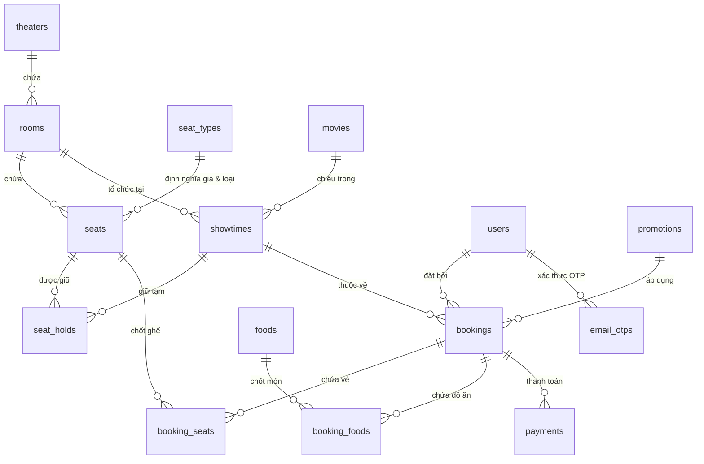
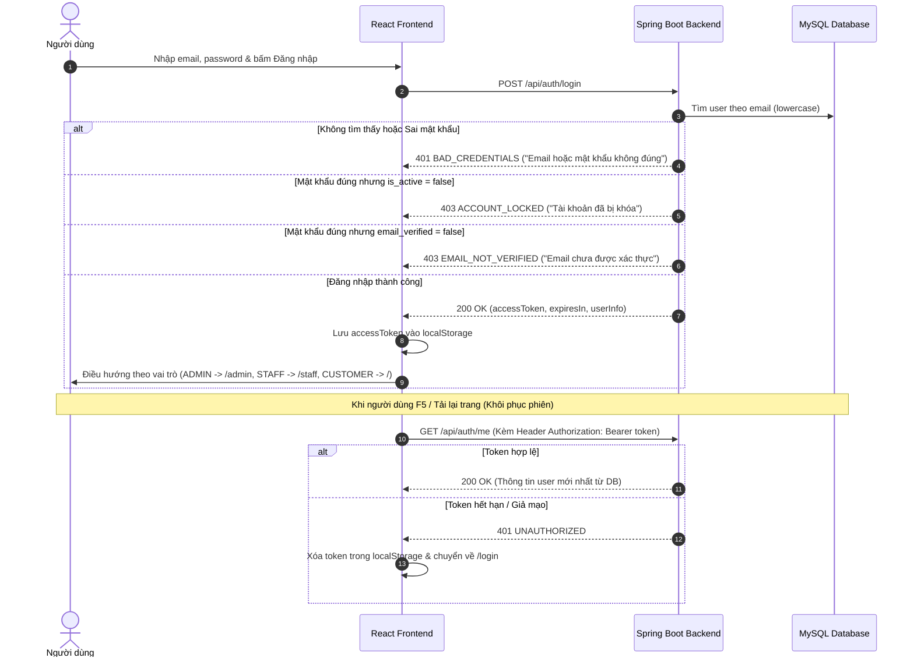
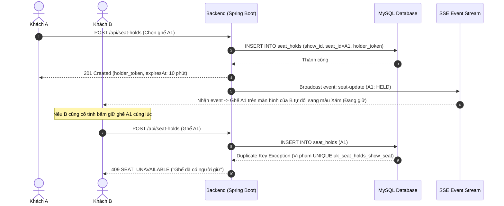

# CẨM NANG TOÀN DIỆN KIẾN THỨC DỰ ÁN & VẬN HÀNH HỆ THỐNG
## PHỤC VỤ BẢO VỆ VÀ VẤN ĐÁP TRƯỚC HỘI ĐỒNG ĐỒ ÁN
**Dự án:** Hệ thống Quản lý và Đặt vé Xem phim trực tuyến – **Akashi Cinema**

---

## MỤC LỤC
1. [Tổng quan Đề tài & Giá trị Nghiệp vụ](#1-tổng-quan-đề-tài--giá-trị-nghiệp-vụ)
2. [Kiến trúc Công nghệ & Lý do Lựa chọn (Tech Stack)](#2-kiến-trúc-công-nghệ--lý-do-lựa-chọn-tech-stack)
3. [Thiết kế Cơ sở Dữ liệu & 16 Bảng Nghiệp vụ](#3-thiết-kế-cơ-sở-dữ-liệu--16-bảng-nghiệp-vụ)
4. [Các Quy trình Vận hành Cốt lõi (Core Workflows)](#4-các-quy-trình-vận-hành-cốt-lõi-core-workflows)
5. [Giải quyết các Bài toán Kỹ thuật Hóc búa (Điểm cộng với Hội đồng)](#5-giải-quyết-các-bài-toán-kỹ-thuật-hóc-búa-điểm-cộng-với-hội-đồng)
6. [Cấu trúc Thư mục & Quy ước Lập trình](#6-cấu-trúc-thư-mục--quy-ước-lập-trình)
7. [Bộ 25 Câu hỏi Vấn đáp Thường gặp & Câu trả lời Mẫu](#7-bộ-25-câu-hỏi-vấn-đáp-thường-gặp--câu-trả-lời-mẫu)

---

## 1. TỔNG QUAN ĐỀ TÀI & GIÁ TRỊ NGHIỆP VỤ

### 1.1. Mục tiêu của Đề tài
- Xây dựng một ứng dụng web hoàn chỉnh phục vụ kinh doanh rạp chiếu phim, tự động hóa toàn bộ quy trình: từ xem lịch chiếu, chọn ghế thời gian thực, đặt đồ ăn, áp mã giảm giá, thanh toán trực tuyến qua mã QR chuyển khoản, đến bán vé tại quầy (POS) cho nhân viên và hệ thống quản trị chuyên sâu cho Admin.

### 1.2. Ma trận Phân quyền (RBAC - Role-Based Access Control)
Hệ thống quản lý 4 nhóm đối tượng:
1. **Khách vãng lai (Public/Anonymous):** Xem danh sách phim, suất chiếu, sơ đồ ghế, tin tức, đăng ký tài khoản, đăng nhập, quên mật khẩu.
2. **Khách hàng (CUSTOMER):** Giữ ghế, đặt vé online, mua combo bắp nước, áp voucher, thanh toán qua QR ngân hàng, xem lịch sử đặt vé của chính mình, tự hủy đơn hàng đang chờ thanh toán.
3. **Nhân viên (STAFF):** Bán vé trực tiếp tại quầy cho khách vãng lai, thu tiền mặt, in vé/tra cứu đơn theo mã `booking_code`, hủy đơn đã thanh toán khi khách có nhu cầu tại quầy.
4. **Quản trị viên (ADMIN):** Toàn quyền hệ thống: quản lý phim, phòng, ghế, tạo suất chiếu, định giá vé & hệ số ngày lễ, quản lý đồ ăn, khuyến mãi, quản lý tài khoản người dùng, xem báo cáo doanh thu.

---

## 2. KIẾN TRÚC CÔNG NGHỆ & LÝ DO LỰA CHỌN (TECH STACK)

Khi hội đồng hỏi: *"Tại sao em chọn công nghệ này mà không chọn công nghệ khác?"*, hãy trả lời dựa trên bảng phân tích sau:

| Tầng | Công nghệ sử dụng | Lý do kỹ thuật lựa chọn (Trả lời Hội đồng) |
|---|---|---|
| **Backend** | **Java (JDK 21) + Spring Boot 3.2.5** | - Nền tảng enterprise mạnh mẽ, bảo mật cao.<br>- Hỗ trợ `@Transactional` bảo đảm tính toàn vẹn dữ liệu (ACID) khi xử lý các nghiệp vụ tài chính và giữ ghế.<br>- Spring Security quản lý phân quyền chặt chẽ.<br>- Hibernate/JPA giúp tối ưu hóa truy vấn và tự động validate khớp cấu trúc CSDL. |
| **Frontend** | **React 18 + Vite + Tailwind CSS** | - Kiến trúc SPA (Single Page Application) giúp trải nghiệm mượt mà, không giật lag chuyển trang.<br>- Vite tối ưu hóa thời gian build/HMR nhờ cơ chế Native ES Modules.<br>- Tailwind CSS giúp thiết kế giao diện hiện đại (glassmorphism, dark mode), tối ưu responsive trên mọi kích thước màn hình. |
| **Cơ sở dữ liệu** | **MySQL 8.0 (chạy qua Docker)** | - RDBMS tiêu chuẩn, độ tin cậy cao, hỗ trợ tốt các ràng buộc khóa ngoại (Foreign Key) và chỉ mục (Index).<br>- Chạy qua Docker giúp đồng nhất môi trường phát triển trên mọi máy tính, không xung đột phiên bản cổng 3306 cài sẵn. |
| **Database Migration** | **Flyway** | - Quản lý phiên bản CSDL theo mã nguồn (`V1__...`, `V2__...`).<br>- Giúp tự động tạo bảng và nạp dữ liệu mẫu khi khởi động app, tránh việc export/import file `.sql` thủ công gây sai lệch dữ liệu. |
| **Xác thực** | **JWT (jjwt 0.12.5) + BCrypt** | - Stateless authentication: Server không cần lưu Session trong RAM, dễ dàng mở rộng (scalable).<br>- BCrypt tự động sinh Salt ngẫu nhiên và băm mật khẩu một chiều chống tấn công Rainbow Table. |
| **Realtime Ghế** | **Server-Sent Events (SSE)** | - Truyền dữ liệu trạng thái ghế (HELD, AVAILABLE, SOLD) theo 1 chiều từ Server xuống hàng ngàn Client.<br>- Nhẹ hơn và ít tốn tài nguyên hơn WebSocket (vì client chỉ nhận broadcast chứ không cần gửi dữ liệu ngược lại qua socket). Tự động reconnect tốt qua HTTP tiêu chuẩn. |
| **Thanh toán** | **Casso Webhook (VietQR)** | - Tự động hóa thanh toán ngân hàng qua mã QR chuẩn Napas247, webhook phản hồi ngay lập tức khi tiền vào tài khoản để kích hoạt vé mà không cần cổng thanh toán trung gian rườm rà. |
| **Lưu trữ Media** | **Cloudinary** | - Lưu trữ hình ảnh poster phim, avatar bên ngoài để giảm tải dung lượng ổ cứng của server và tận dụng CDN phân phối ảnh siêu tốc. |

---

## 3. THIẾT KẾ CƠ SỞ DỮ LIỆU & 16 BẢNG NGHIỆP VỤ

CSDL được chuẩn hóa tối ưu gồm **16 bảng**, chia làm 7 phân vùng rõ ràng:



### 3.1. Danh mục 7 Nhóm Bảng
1. **Hạ tầng rạp:**
   - `theaters`: Thông tin rạp (mở rộng đa cụm rạp trong tương lai).
   - `rooms`: Phòng chiếu thuộc rạp (`is_active` đánh dấu phòng còn hoạt động).
   - `seat_types`: Loại ghế (`STANDARD`, `VIP`, `COUPLE`), quy định giá gốc (`base_price`) và số người ngồi (`people_count`).
   - `seats`: Toạ độ vật lý từng ghế (`row_num`, `col_num`) theo phòng chiếu.
2. **Người dùng & Xác thực:**
   - `users`: Thông tin tài khoản, vai trò (`ADMIN`, `STAFF`, `CUSTOMER`), mật khẩu băm `password_hash`, cờ `email_verified`, cờ `is_active`.
   - `email_otps`: Mã OTP 6 chữ số gửi qua mail để đăng ký hoặc lấy lại mật khẩu. Mã được băm `code_hash` và có số lần thử tối đa (`attempts`).
3. **Phim & Lịch chiếu:**
   - `movies`: Phim, độ tuổi (`P`, `T13`, `T16`, `T18`), thời lượng, trạng thái (`COMING_SOON`, `NOW_SHOWING`, `ENDED`), cờ `is_active` (xóa mềm).
   - `showtimes`: Suất chiếu gắn với phim và phòng. `end_time` do hệ thống tự tính: `start_time + duration + showtime-cleaning-minutes`. Có hệ số giá `price_multiplier`.
4. **Đồ ăn & Ưu đãi:**
   - `foods`: Bắp, nước, combo kèm giá niêm yết hiện tại.
   - `promotions`: Mã giảm giá theo phần trăm (`PERCENT`) hoặc số tiền cố định (`FIXED`), giá trị đơn tối thiểu (`min_order_value`), ngày hết hạn.
5. **Nghiệp vụ Đặt vé:**
   - `bookings`: Đơn hàng chứa `booking_code` (mã vé 8-12 ký tự in trên QR/chuyển khoản), kênh bán (`ONLINE` hoặc `COUNTER`), trạng thái đơn (`PENDING`, `PAID`, `CANCELLED`, `EXPIRED`), tổng tiền.
   - `seat_holds`: Bảng giữ ghế tạm thời chống tranh chấp ghế. Lưu `holder_token`, thời hạn giữ (`expires_at`), giá ghế đã chốt tại thời điểm giữ.
   - `booking_seats`: Ghế chính thức đã bán của đơn hàng. Ràng buộc `UNIQUE(show_id, seat_id)` ngăn chặn 100% việc bán trùng ghế.
   - `booking_foods`: Chi tiết đồ ăn đi kèm đơn đặt vé.
6. **Thanh toán:**
   - `payments`: Lịch sử giao dịch (`BANK_TRANSFER`, `CASH`), lưu mã giao dịch `transaction_id`, trạng thái (`SUCCESS`, `FAILED`) và lưu nguyên bản webhook `raw_payload` để phục vụ đối soát tài chính.
7. **Tin tức:**
   - `news`: Bài viết khuyến mãi, sự kiện điện ảnh trên trang chủ.

### 3.2. Ba Nguyên tắc Thiết kế CSDL Xuất sắc Cần Nêu Bật:
1. **Cơ chế Snapshot Giá (Price Snapshot Pattern):**
   - Giá ghế (`booking_seats.price`) và giá đồ ăn (`booking_foods.unit_price`) được chép cứng giá trị tại thời điểm tạo đơn. Dù sau này Admin có tăng giá vé hay giá bắp rang bơ trong bảng `seat_types` hay `foods`, doanh thu và lịch sử đơn hàng cũ hoàn toàn không bị ảnh hưởng.
2. **Chiến lược Xóa mềm (Soft Delete):**
   - Tuyệt đối không dùng lệnh `DELETE` vật lý đối với `users`, `movies`, `rooms`, `showtimes`. Sử dụng cờ `is_active = 0` để ẩn khỏi giao diện khách hàng nhưng vẫn bảo toàn toàn vẹn tham chiếu (Foreign Key) cho các báo cáo doanh thu và lịch sử đặt vé quá khứ.
3. **Chống trùng ghế 2 tầng (Two-Tier Locking):**
   - Tầng 1 (Tạm thời): Ràng buộc `UNIQUE (show_id, seat_id)` trên bảng `seat_holds`.
   - Tầng 2 (Vĩnh viễn): Ràng buộc `UNIQUE (show_id, seat_id)` trên bảng `booking_seats`.

---

## 4. CÁC QUY TRÌNH VẬN HÀNH CỐT LÕI (CORE WORKFLOWS)

### 4.1. Quy trình Xác thực & Phục hồi Phiên (Auth Flow)



### 4.2. Quy trình Giữ Ghế & Đặt Vé Realtime (Concurrency & Booking Flow)



### 4.3. Quy trình Thanh toán Casso & Kích hoạt Vé
1. Khách tạo đơn hàng: Hệ thống sinh mã `booking_code` duy nhất (ví dụ: `AK78291A`).
2. Giao diện hiển thị mã VietQR chứa đúng số tài khoản, số tiền và nội dung chuyển khoản là `AK78291A`.
3. Khách quét mã trên app ngân hàng và bấm chuyển khoản.
4. Tiền vào tài khoản chủ rạp -> Casso nhận biến động số dư và bắn Webhook `POST /api/webhooks/casso` về Backend.
5. Backend nhận Webhook:
   - Đọc nội dung giao dịch, dùng regex bóc tách mã `booking_code`.
   - Kiểm tra số tiền nhận được so với `bookings.total_price`.
   - Cập nhật trạng thái `bookings.booking_status = 'PAID'`.
   - Xóa dòng tạm ở `seat_holds` và ghi vào `booking_seats`.
   - Lưu vết giao dịch vào `payments` kèm `raw_payload`.
   - Bắn mail thông báo vé điện tử kèm mã QR vào email của khách.
   - Frontend (đang mở màn hình chờ thanh toán) nhận phản hồi thành công và tự động chuyển sang trang *"Vé của bạn"*.

---

## 5. GIẢI QUYẾT CÁC BÀI TOÁN KỸ THUẬT HÓC BÚA (ĐIỂM CỘNG VỚI HỘI ĐỒNG)

Khi bảo vệ đồ án, thầy cô hội đồng thường xoáy sâu vào các **trường hợp biên (edge cases)** và **tính chịu tải, an toàn dữ liệu**. Dưới đây là cách hệ thống giải quyết:

### 5.1. Bài toán Race Condition (2 người cùng bấm đặt 1 ghế cùng một thời điểm)
- **Vấn đề:** Nếu 2 request cùng đọc DB thấy ghế trống rồi cùng ghi, ghế sẽ bị bán trùng (Double Booking).
- **Giải pháp của hệ thống:**
  1. Sử dụng ràng buộc mức Cơ sở dữ liệu: `CONSTRAINT uk_seat_holds_show_seat UNIQUE (show_id, seat_id)`.
  2. Bọc logic giữ ghế trong một `@Transactional` của Spring Boot.
  3. Khi 2 giao dịch đồng thời xảy ra, MySQL đảm bảo chỉ có 1 giao dịch commit thành công, giao dịch còn lại sẽ bị `DataIntegrityViolationException`. Service bắt lỗi này và ném mã lỗi HTTP `409 SEAT_UNAVAILABLE`.
  4. Sau đó Server đẩy tín hiệu SSE tới toàn bộ client để cập nhật trạng thái ngay lập tức trên UI.

### 5.2. Bài toán Chống Tấn công Dò Tìm Tài Khoản (Timing Attack & User Enumeration)
- **Vấn đề:** Tin tặc nhập thử hàng nghìn email; nếu server trả về *"Email không tồn tại"* thì tin tặc sẽ biết được danh sách email người dùng của hệ thống. Ngoài ra, nếu email có thật server mới chạy mã băm BCrypt (tốn ~100ms) còn email không có thì trả về ngay (5ms), tin tặc đo thời gian phản hồi (Timing Attack) để đoán email.
- **Giải pháp:**
  - Quy tắc `BR-AUTH-09`: Sai email hay sai mật khẩu đều trả về **chính xác một câu thông báo duy nhất**: *"Email hoặc mật khẩu không đúng"*.
  - Tại code Backend `AuthService.java`: Nếu email không tồn tại trong DB, hệ thống vẫn cố tình thực hiện `passwordEncoder.matches(request.getPassword(), DUMMY_BCRYPT_HASH)` để thời gian xử lý luôn tương đương nhau, triệt tiêu hoàn toàn nguy cơ Timing Attack.

### 5.3. Bài toán Bảo vệ Đơn hàng (IDOR - Insecure Direct Object References)
- **Vấn đề:** Khách A có đơn hàng số 10. Khách B sửa URL thành `/api/bookings/10` để xem trộm thông tin vé của khách A.
- **Giải pháp:**
  - Quy tắc `BR-ROLE-02`: Tại Service, hệ thống kiểm tra `booking.getUserId().equals(currentUserId)`.
  - Nếu không phải chủ đơn (và không phải ADMIN/STAFF), hệ thống trả về mã **404 NOT_FOUND** thay vì 403 FORBIDDEN. Điều này giúp không làm lộ thông tin rằng đơn hàng số 10 có tồn tại trên đời hay không.

### 5.4. Bài toán Đảm bảo Toàn vẹn Dữ liệu Tài chính
- **Vấn đề:** Không được tin tưởng dữ liệu tiền gửi từ Client lên (khách có thể dùng Postman sửa giá vé từ 100.000đ thành 1.000đ).
- **Giải pháp:** Client chỉ gửi `seatIds`, `showId`, `foodIds`, `promoCode`. Mọi phép tính nhân hệ số giá (`price_multiplier`), giá ghế, giá bắp nước và giảm giá voucher đều được thực hiện **độc quyền tại `PricingService` ở Backend**.

---

## 6. CẤU TRÚC THƯ MỤC & QUY ƯỚC LẬP TRÌNH

Dự án áp dụng mô hình phân tách rõ ràng giữa Client và Server:

```
DoAnCoSo2/
├── backend/                       # REST API Spring Boot 3.2.5
│   └── src/main/java/com/akashi/cinema/
│       ├── config/                # Cấu hình Security, CORS, Cloudinary
│       ├── controller/            # Tầng Controller (mỏng, chỉ nhận request & map DTO)
│       ├── service/               # Tầng Service (toàn bộ nghiệp vụ & @Transactional)
│       ├── repository/            # Tầng truy vấn Spring Data JPA
│       ├── entity/                # Ánh xạ Object-Relational (ORM)
│       ├── dto/                   # Data Transfer Object (Request / Response)
│       ├── exception/             # Xử lý lỗi tập trung GlobalExceptionHandler
│       └── security/              # Bộ lọc JWT, CustomUserDetails, JwtTokenProvider
│   └── src/main/resources/
│       ├── application.yml        # Cấu hình biến môi trường
│       └── db/migration/          # Các script Flyway (V1, V2, ...)
│
├── frontend/                      # Single Page Application (React + Vite)
│   └── src/
│       ├── api/                   # axiosClient cấu hình sẵn & các module gọi API
│       ├── contexts/              # AuthContext quản lý state đăng nhập toàn ứng dụng
│       ├── routes/                # ProtectedRoute phân quyền theo role
│       ├── pages/                 # Các trang giao diện (LoginPage, HomePage, AdminPage...)
│       ├── components/            # Thành phần giao diện dùng chung
│       └── styles/                # Tailwind CSS & Biến màu thương hiệu
```

---

## 7. BỘ 25 CÂU HỎI VẤN ĐÁP THƯỜNG GẶP & CÂU TRẢ LỜI MẪU

### Nhóm 1: Cơ sở dữ liệu & Kiến trúc
**Câu 1: Tại sao em dùng Flyway thay vì để Hibernate tự sinh bảng (`ddl-auto: update`)?**
> *Trả lời:* Dùng `ddl-auto: update` trong môi trường thực tế rất nguy hiểm vì Hibernate có thể tự ý thay đổi cột, không quản lý được lịch sử thay đổi và không đồng bộ được giữa các thành viên trong nhóm. Flyway giúp quản lý phiên bản CSDL bằng các file migration SQL tường minh, có kiểm tra checksum, đảm bảo mọi môi trường chạy (dev, test, production) đều có cấu trúc bảng hoàn toàn giống nhau. Dự án đặt `ddl-auto: validate` để bắt buộc Entity phải chuẩn xác từng trường với DB.

**Câu 2: Tại sao mật khẩu và mã OTP không lưu trực tiếp mà phải băm (Hash)?**
> *Trả lời:* Để tuân thủ nguyên tắc bảo mật. Nếu CSDL bị lộ (data leak), kẻ tấn công cũng không thể dịch ngược được mật khẩu gốc hay mã OTP của người dùng. Hệ thống dùng thuật toán BCrypt có kèm Salt ngẫu nhiên và Work Factor để chống tấn công vét cạn (brute-force) và từ điển (rainbow table).

**Câu 3: Bảng `seats` và bảng `rooms` liên kết với nhau như thế nào? Làm sao biết ghế nào hỏng?**
> *Trả lời:* Bảng `seats` liên kết với `rooms` qua `room_id`. Mỗi ghế có tọa độ `(row_num, col_num)`. Để quản lý ghế hỏng, bảng `seats` có cột `is_active (BOOLEAN)`. Nếu ghế bị hỏng, Admin đổi `is_active = 0`, sơ đồ ghế của khách hàng sẽ không cho phép click vào ghế này.

**Câu 4: Khi giá vé thay đổi thì các đơn hàng cũ có bị đổi giá theo không? Tại sao?**
> *Trả lời:* Không ạ. Đây là điểm thiết kế quan trọng: Bảng `seat_types` lưu `base_price` (giá hiện tại), nhưng khi khách đặt vé, giá tại thời điểm đó sẽ được chép cứng (snapshot) vào cột `price` của bảng `booking_seats`. Do đó, lịch sử đơn hàng luôn bảo toàn đúng số tiền khách đã trả.

**Câu 5: Tại sao trong bảng `bookings` lại có trường `created_by` và trường `channel`?**
> *Trả lời:* Để phân biệt hai kênh bán vé: `channel = ONLINE` (khách tự đặt trên web, `created_by = NULL`, có `user_id`) và `channel = COUNTER` (khách mua tại quầy, `created_by` là `user_id` của nhân viên bán vé, còn `user_id` của khách có thể để `NULL` đối với khách vãng lai).

---

### Nhóm 2: Bảo mật & Xác thực (Security & Auth)
**Câu 6: Cơ chế hoạt động của JWT trong ứng dụng này như thế nào?**
> *Trả lời:* Khi đăng nhập thành công, Server tạo ra một chuỗi JSON Web Token được ký bằng khóa bí mật (`HS256` hoặc `HS512`). Chuỗi này chứa payload gồm `userId` và `role`. Client nhận token và lưu vào `localStorage`. Với mọi request sau đó, `axiosClient` tự động gắn token vào Header `Authorization: Bearer <token>`. Filter của Spring Security sẽ giải mã token, xác thực chữ ký và nạp quyền vào `SecurityContext` mà không cần query lại mật khẩu từ DB.

**Câu 7: JWT có nhược điểm gì và em xử lý nhược điểm đó ra sao?**
> *Trả lời:* Nhược điểm lớn nhất của JWT là stateless nên không thể thu hồi (revoke) ngay lập tức trước khi nó hết hạn nếu bị lộ token. Để hạn chế rủi ro này, em cấu hình thời gian sống của token ngắn (`jwt-expiry-minutes = 60 phút`) theo quy tắc `BR-AUTH-13`.

**Câu 8: Ở giao diện em đã ẩn nút của Admin đối với tài khoản Customer rồi, vậy đã an toàn chưa?**
> *Trả lời:* Chưa an toàn ạ. Việc ẩn nút ở giao diện chỉ nhằm mục đích tối ưu trải nghiệm người dùng (UX). Bất kỳ ai cũng có thể dùng công cụ như Postman để gửi thẳng request đến API. Do đó, việc bảo mật bắt buộc phải nằm ở Backend: tại các controller/service em sử dụng `@PreAuthorize("hasRole('ADMIN')")` kết hợp với bộ lọc Spring Security để từ chối truy cập 403 nếu token không có vai trò hợp lệ.

**Câu 9: Khi người dùng F5 tải lại trang, hệ thống giữ trạng thái đăng nhập như thế nào?**
> *Trả lời:* Trong `AuthContext.jsx`, khi component mount lần đầu, hệ thống kiểm tra xem trong `localStorage` có token hay không. Nếu có, nó sẽ phát một request `GET /api/auth/me`. Backend kiểm tra token hợp lệ và trả về thông tin user mới nhất. Trong lúc chờ xác thực, React hiển thị trạng thái loading để tránh việc điều hướng nhầm về trang đăng nhập.

**Câu 10: Xử lý thế nào khi người dùng nhập sai mật khẩu quá nhiều lần?**
> *Trả lời:* Theo quy tắc `BR-AUTH-12`, nếu sai liên tiếp quá 5 lần (`login-max-failures`), hệ thống sẽ tạm khóa việc đăng nhập của email đó trong vòng 15 phút (`login-lock-minutes`). Việc đếm số lần sai được lưu trong bộ nhớ cache của backend để tối ưu hiệu năng mà không cần sửa cấu trúc bảng DB.

---

### Nhóm 3: Nghiệp vụ & Kỹ thuật Xử lý Đồng thời (Concurrency)
**Câu 11: Em xử lý thế nào để người này không mua đè lên ghế của người khác đang chọn?**
> *Trả lời:* Em áp dụng cơ chế Giữ ghế tạm thời (Seat Hold):
> 1. Khi khách chọn ghế, hệ thống ghi nhận vào bảng `seat_holds` với thời hạn 10 phút. Ràng buộc `UNIQUE(show_id, seat_id)` ngăn không cho bất kỳ ai giữ trùng ghế này.
> 2. Hệ thống phát sự kiện qua Server-Sent Events (SSE) để các màn hình khác lập tức chuyển ghế đó sang màu xám.
> 3. Nếu sau 10 phút khách không hoàn tất thanh toán, hệ thống sẽ tự động giải phóng ghế này về trạng thái `AVAILABLE`.

**Câu 12: Tại sao em dùng SSE (Server-Sent Events) mà không dùng WebSocket cho sơ đồ ghế?**
> *Trả lời:* Vì sơ đồ ghế chỉ cần luồng truyền thông tin một chiều: Server gửi thông báo cập nhật trạng thái ghế (`AVAILABLE`, `HELD`, `SOLD`) tới các Client đang xem suất chiếu đó. SSE chạy trên giao thức HTTP tiêu chuẩn, nhẹ hơn WebSocket, tự động hỗ trợ cơ chế kết nối lại (reconnect) khi rớt mạng và không đòi hỏi chi phí duy trì kênh full-duplex hai chiều phức tạp như WebSocket.

**Câu 13: Làm sao tính được thời gian kết thúc của một suất chiếu?**
> *Trả lời:* Thời gian kết thúc không do Admin nhập tay để tránh sai sót. Theo quy tắc `BR-SHOW-01`, hệ thống tự tính toán tự động theo công thức:
> `end_time = start_time + movie.duration (thời lượng phim) + showtime-cleaning-minutes (thời gian dọn phòng, mặc định 15 phút)`.

**Câu 14: Hệ thống ngăn chặn việc xếp lịch chiếu trùng giờ trong cùng một phòng như thế nào?**
> *Trả lời:* Tại `ShowtimeService`, trước khi thêm hoặc sửa suất chiếu, hệ thống kiểm tra logic chống chồng giờ (`BR-SHOW-02`): Suất chiếu mới `[start, end]` sẽ vi phạm nếu tồn tại một suất cũ trong cùng phòng có: `new.start_time < old.end_time AND new.end_time > old.start_time`. Nếu vi phạm, server sẽ chặn lại và báo lỗi `409 SHOWTIME_OVERLAP`.

**Câu 15: Tại sao đơn hàng hết hạn thanh toán thì ghế lại được nhả ra?**
> *Trả lời:* Đơn hàng ở trạng thái `PENDING` có trường `expires_at` (thường bằng thời hạn giữ ghế). Hệ thống có một tác vụ ngầm (Scheduled Task) chạy định kỳ quét các đơn có `status = PENDING` và `expires_at < NOW()`. Tác vụ này sẽ cập nhật đơn sang `EXPIRED`, xóa các bản ghi ở `seat_holds` và bắn sự kiện SSE để ghế khả dụng trở lại cho khách khác mua.

---

### Nhóm 4: Lập trình Frontend (React)
**Câu 16: `axiosClient` trong dự án được cấu hình những gì đặc biệt?**
> *Trả lời:* `axiosClient` có 2 interceptor quan trọng:
> 1. **Request Interceptor:** Tự động lấy token từ `localStorage` và đính kèm vào Header `Authorization: Bearer <token>` trước khi mọi request được gửi đi.
> 2. **Response Interceptor:** Bắt lỗi 401 Unauthorized từ server. Nếu lỗi 401 không phải xuất phát từ trang login (ví dụ token hết hạn khi đang thao tác), interceptor sẽ tự động xóa token hỏng và điều hướng người dùng về `/login`.

**Câu 17: `ProtectedRoute` hoạt động ra sao và kiểm tra phân quyền như thế nào?**
> *Trả lời:* `ProtectedRoute` là một component bọc các route cần bảo vệ:
> - Nó lấy trạng thái `user` và `loading` từ `AuthContext`.
> - Nếu chưa đăng nhập, nó render `<Navigate to="/login" replace />`.
> - Nếu nhận prop `roles` (ví dụ `['ADMIN']`), nó kiểm tra xem `user.role` có nằm trong danh sách được phép hay không. Nếu sai vai trò, nó tự động đẩy về trang chủ hợp lệ của người đó (`ADMIN` về `/admin`, `STAFF` về `/staff`, `CUSTOMER` về `/`).

**Câu 18: Các liên kết chưa làm như "Quên mật khẩu?" hay "Đăng ký ngay" được xử lý thế nào ở giai đoạn này?**
> *Trả lời:* Được tạo đầy đủ giao diện, màu sắc chuẩn theo bản thiết kế UI mẫu nhưng được gắn chú thích `TODO` trong code và để sự kiện no-op (không chuyển hướng đi đâu) để sẵn sàng mở rộng khi làm đến các tính năng tiếp theo.

---

### Nhóm 5: Tình huống Thực tế & Vận hành (DevOps / Testing)
**Câu 19: Nếu máy chủ ngân hàng bị chậm, khách đã chuyển tiền nhưng Webhook Casso chưa gọi về thì xử lý thế nào?**
> *Trả lời:* 
> 1. Trên giao diện chờ thanh toán, Frontend có cơ chế Polling (gọi định kỳ mỗi 3 - 5 giây) gọi `GET /api/bookings/{id}` để cập nhật trạng thái đơn ngay khi webhook cập nhật DB.
> 2. Nếu quá hạn giữ ghế mà tiền mới về tài khoản, giao dịch sẽ được ghi nhận vào `payments` ở trạng thái chờ đối soát, và nhân viên quầy có quyền tra cứu `booking_code` để kích hoạt vé thủ công cho khách hoặc hoàn tiền.

**Câu 20: Làm thế nào để chạy toàn bộ hệ thống này trên một máy tính mới hoàn toàn?**
> *Trả lời:* Theo tài liệu `docs/SetUpEveryday.md`:
> 1. Khởi động Docker Desktop và chạy `docker compose up -d mysql` để bật CSDL MySQL trên cổng 3307.
> 2. Chạy Backend bằng JDK 21: Spring Boot kết nối MySQL, Flyway tự động tạo 16 bảng và nạp tài khoản mẫu.
> 3. Chạy Frontend: Vào thư mục `frontend`, chạy `npm install` và `npm run dev`. Trình duyệt mở `http://localhost:5173`.

---

## TỔNG KẾT BÍ QUYẾT BẢO VỆ ĐỒ ÁN ĐIỂM CAO
1. **Bình tĩnh, tự tin:** Trả lời dứt khoát, đi thẳng vào bản chất kỹ thuật thay vì mô tả chung chung.
2. **Nhấn mạnh vào tính toàn vẹn dữ liệu:** Thầy cô đánh giá rất cao việc bạn hiểu về `@Transactional`, Khóa ngoại, Ràng buộc `UNIQUE` chống mua trùng ghế và cơ chế Snapshot giá.
3. **Thừa nhận phạm vi:** Nếu được hỏi một tính năng chưa làm (ví dụ hoàn tiền tự động qua ngân hàng), hãy trả lời: *"Dạ hiện tại hệ thống giải quyết việc này qua quy trình đối soát tại quầy của Staff bằng bảng `payments`, và đây là hướng mở rộng tiếp theo của nhóm em ạ."*
